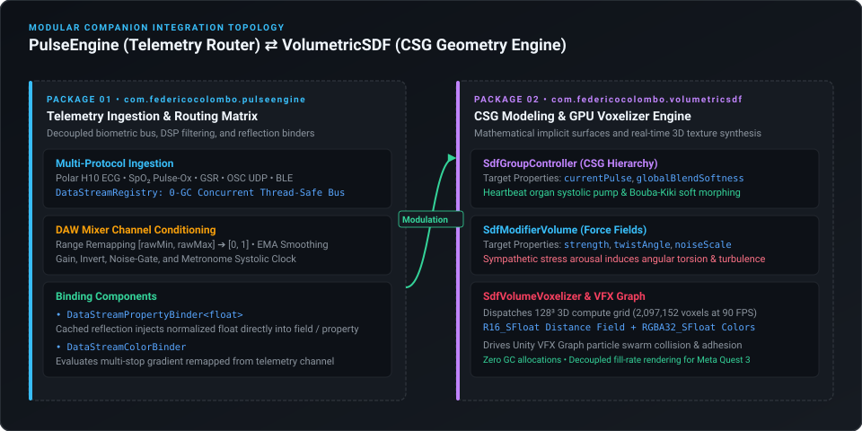

# Driving VolumetricSDF with PulseEngine

`PulseEngine` is designed as a standalone, domain-agnostic telemetry routing console. When combined with our companion package **[VolumetricSDF](https://github.com/federicocolombo12/VolumetricSDF)** (`com.federicocolombo.volumetricsdf`), it creates an end-to-end biological and generative audiovisual pipeline.

---

## 1. System Topology

  

---

## 2. Recommended Parameter Bindings

| Telemetry Channel | Target VolumetricSDF Component | Target Property Name | Clinical / Creative Metaphor |
| :--- | :--- | :--- | :--- |
| **`heart_rate`** | `SdfGroupController` | `currentPulse` | Rhythmic organ systolic contraction and diastolic relaxation. |
| **`hrv_rmssd`** | `SdfGroupController` | `globalBlendSoftness` | Vagal nerve parasympathetic tone: high HRV relaxes shapes into smooth Bouba; low HRV sharpens edges. |
| **`spo2`** | `VisualEffect` | `ParticleScale` / `Turbulence` | Blood oxygenation: healthy SpO2 ($>97\%$) produces calm coherent flow; hypoxia induces erratic dispersion. |
| **`stress_index`** | `SdfModifierVolume` | `strength` | Autonomic arousal drives twisting and high-frequency surface noise deformation. |

---

## 3. Step-by-Step Setup

1. **Install Both Packages** via UPM:
   * `https://github.com/federicocolombo12/PulseEngine.git`
   * `https://github.com/federicocolombo12/VolumetricSDF.git`
2. **In Your Scene**:
   * Add the `SDF_Volume` GameObject with `SdfGroupController` and `SdfVolumeVoxelizer` (from `VolumetricSDF`).
   * Add a `DataStreamRegistry` and `DataStreamSimulatorSource` (from `PulseEngine`).
3. **Attach a Binder**:
   * On your `SDF_Volume` GameObject, attach **`DataStreamPropertyBinder`**.
   * Set `Channel ID`: `heart_rate`.
   * Set `Target Component`: `SdfGroupController`.
   * Set `Target Property Name`: `currentPulse`.
   * Check **Use Local Remap**: Remap `[0.0, 1.0]` $\rightarrow$ `[0.0, 0.25]`.
4. **Open Virtual DAW Mixer**:
   * Go to **Window** > **PulseEngine** > **Virtual DAW Mixer**.
   * Move the `heart_rate` fader or connect an OSC stream: your procedural SDF volume dynamically pulses in real time!
