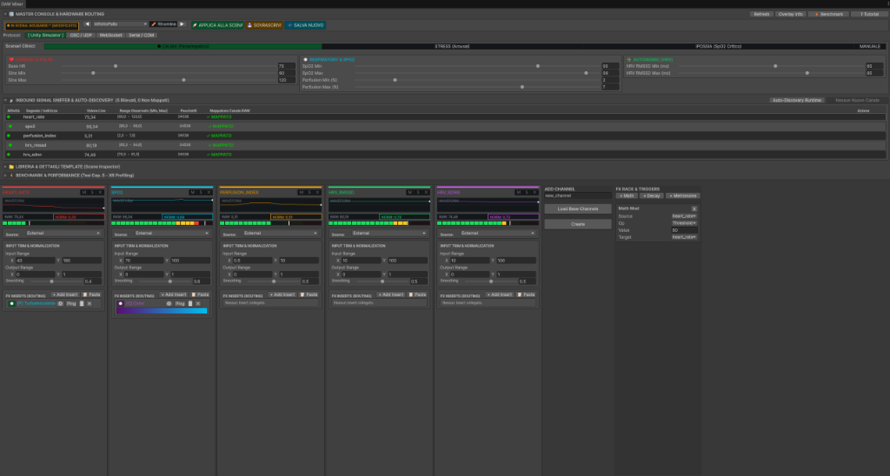
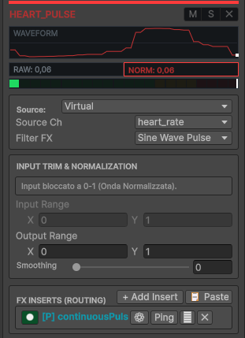

# PulseEngine 🫀⚡

> **High-Performance Virtual DAW Mixer & Real-Time Telemetry Routing Engine for Unity 6**  
> Connect real-time telemetry (biometric sensors, network sockets, audio, simulators) directly to Unity components, shaders, particle swarms, and companion procedural engines.

[](https://unity.com/)
[](https://unity.com/srp/universal-render-pipeline)
[](https://unity.com/visual-effect-graph)
[](https://www.meta.com/quest/quest-3/)
[](#performance--benchmarks)
[](https://federicocolombo12.github.io/PulseEngine/)
[](LICENSE.md)

---

## 🌟 Overview

> 📖 **Full Technical Documentation & Architecture Manual**:  
> Explore guides, benchmarks, and interactive diagrams at **[federicocolombo12.github.io/PulseEngine](https://federicocolombo12.github.io/PulseEngine/)**

> [!TIP]
> **Modular Decoupling**: PulseEngine is designed as a standalone telemetry routing and Virtual DAW Mixer console. For standalone procedural CSG modeling, modifier volumes, and GPU voxelization, see the companion package **[VolumetricSDF](https://github.com/federicocolombo12/VolumetricSDF)**.

**PulseEngine** bridges continuous telemetry streams with high-end real-time computer graphics. 

Built following professional audio production paradigms, it provides a **Virtual DAW Mixer Console** inside Unity that routes, normalizes, and filters multi-protocol signals (OSC, WebSockets, Serial, Simulators) to drive:
1. **Universal Scene Parameters**: Real-time cached reflection delegates modulating Materials, Shaders, Transforms, Lights, and Audio DSP with zero boilerplate.
2. **GPU Particle Swarms (Unity VFX Graph)**: Live dynamic blackboard property modulation (Turbulence, Spawn Rate, Particle Velocity, Vector Fields).
3. **Clinical & Creative Biofeedback**: Flagship medical XR interoceptive loops translating heart rate (BPM), blood oxygenation (SpO2), and autonomic stress (HRV RMSSD) into visceral perceptual metaphors.
4. **Companion Procedural Geometry ([VolumetricSDF](https://github.com/federicocolombo12/VolumetricSDF))**: Seamlessly pairs with our companion package to sculpt dynamic CSG implicit geometry, bounded modifier volumes, and 128³ GPU voxel grids.

<p align="center">
  <a href="https://github.com/federicocolombo12/PulseEngine/raw/main/Documentation~/images/demo_raw.mp4">
    
  </a>
  <br>
  <b>🎬 <a href="https://github.com/federicocolombo12/PulseEngine/raw/main/Documentation~/images/demo_raw.mp4">Watch Full 1080p In-Editor Video Walkthrough (75s)</a></b>
  <br>
  <em>Live demonstration of the Virtual DAW Mixer console, multi-channel telemetry routing, real-time OLED oscilloscopes, and GPU particle swarm voxelization.</em>
</p>

<p align="center">
  
  
</p>

---

## 🚀 Key Features

### 🎛️ 1. Virtual DAW Mixer Console (`DAWMixerWindow`)
* **Hardware Channel Strips**: Familiar audio workstation workflow with interactive faders, real-time OLED oscilloscopes, VU meters, and gain calibration.
* **Engine-Level Mute [M] & Solo [S]**: Silences signal modulation and automatically restores restful baselines without disrupting network ingestion.
* **Inbound Signal Sniffer & Auto-Discovery**: Automatically listens to incoming telemetry, discovers unmapped keys, and configures calibrated channels with a single click.
* **1-Click Preset Snapshots**: Save, hot-swap, and overwrite complete system states (channels, faders, node hierarchies, materials, gradients) as ScriptableObjects.

<p align="center">
  
  
</p>

### ⚡ 2. Zero-GC Telemetry Bus & Signal Processing
* **Allocation-Free Dispatching**: Thread-safe `DataStreamRegistry` operates with strictly **0 Bytes GC allocation per frame**, executing at full target XR framerate ($72\text{ Hz} / 90\text{ Hz} / 120\text{ Hz}$).
* **Multi-Stage Mathematical Filtering**:
  * **Adaptive Low-Pass**: Exponential moving smoothing ($y_t = y_{t-1} + \alpha (x_t - y_{t-1})$) eliminating sensor quantization noise.
  * **Spike Rejection**: Threshold-based outlier clipping guarding against loose electrode or wireless transmission dropouts.
  * **Anti-Jitter Metronome (`SineWavePulse`)**: Converts irregular network packets into continuous rhythmic phase oscillators ($\sin(\phi)$) with continuous phase integration across delta time.
* **Multi-Protocol Ingestion**: Native decoupled support for **OSC (Open Sound Control)**, UDP sockets, WebSockets, Serial COM ports, and internal scenario simulators.

### 🔌 3. Universal Parameter & Visual Binders
`PulseEngine` is completely modular and drives **any component in Unity** without writing boilerplate code:
* **Materials & Shaders**: Modulate Albedo, Emission colors, Fresnel intensity, and custom Shader Graph blackboard properties via `DataStreamPropertyBinder` and `DataStreamColorBinder`.
* **Transforms**: Smoothly scale, rotate, and displace scene objects with customizable weight multipliers and local remap curves.
* **Lights & Environment**: Sync room illumination, point light intensity, and volumetric fog density with patient respiration or heartbeat.
* **Audio Sources**: Modulate volume, pitch, and low-pass filter cutoff frequencies based on autonomic stress telemetry.
* **Unity VFX Graph**: Direct binding to VFX Graph blackboard floats, vectors, and color gradients (e.g. Turbulence, Spawn Rate, Particle Lifetime).

### 🧬 4. Modular Ecosystem: VolumetricSDF Companion
While `PulseEngine` is domain-agnostic and drives standard Unity objects, lights, and materials, it pairs seamlessly with our dedicated procedural volumetric engine:

👉 **[VolumetricSDF](https://github.com/federicocolombo12/VolumetricSDF)** (`com.federicocolombo.volumetricsdf`)

* **Procedural Geometry Control**: Route `heart_rate` directly into `SdfGroupController.currentPulse` for rhythmic anatomical expansion and contraction.
* **Affective Morphology**: Route `hrv_rmssd` into `globalBlendSoftness` to morph smoothly between rounded parasympathetic topologies (**Bouba**) and angular sympathetic spikes (**Kiki**).
* **Physics & VFX Adhesion**: Feed GPU voxelized signed distance volumes into VFX Graph swarms with decoupled world-space chromatic evaluation.

---

## 📊 Performance & Mobile VR Benchmarks

PulseEngine is engineered for high-cadence XR headsets (Meta Quest 3, Apple Vision Pro, PCVR) where memory allocation pauses cause catastrophic frame drops.

### Zero-GC Telemetry Ingestion
Profiling over 1,000 consecutive frames with high-frequency network packets (>250 Hz) confirms:
* **Garbage Collector Allocations**: **0.0 Bytes / frame** (lock-free pre-allocated ringbuffer).
* **Execution Time (Main Thread Dispatch)**: **< 0.04 ms / frame** (in-place primitive math & cached delegates).

### End-to-End System Performance (Paired with VolumetricSDF)
Empirical profiling results captured on **Meta Quest 3 (Standalone Android OpenXR)** across 13 test conditions:

| Condition / Mode | Resolution | Avg FPS | Frame Time | VRAM Footprint | GC Alloc / Frame |
| :--- | :---: | :---: | :---: | :---: | :---: |
| **Physics-Only Mode** | $32^3$ | **90.0 FPS** | **2.91 ms** | 0.25 MB | **0 Bytes** |
| **Physics-Only Mode** | $64^3$ | **90.0 FPS** | **3.03 ms** | 2.00 MB | **0 Bytes** |
| **Physics-Only Mode** | $128^3$ | **89.9 FPS** | **4.12 ms** | 16.00 MB | **0 Bytes** |
| **Full Solid Raymarch** | $64^3$ | **72.1 FPS** | **7.84 ms** | 2.00 MB | **0 Bytes** |
| **Bouba-Kiki Stress Test** | $64^3$ | **90.0 FPS** | **3.08 ms** | 2.00 MB | **0 Bytes** |

> [!NOTE]
> *Physics-Only Mode* achieves a **61.3% reduction in GPU frame time**, providing a guaranteed 90 Hz headroom for clinical applications where motion sickness prevention is critical. See [VolumetricSDF Benchmarks](https://federicocolombo12.github.io/VolumetricSDF/manual/quest3-profiling.html) for detailed GPU kernel profiling.

---

## 📦 Installation

Add PulseEngine to your Unity project via the **Package Manager** using the Git URL:

```text
https://github.com/federicocolombo12/PulseEngine.git
```

For detailed setup instructions, see the [Installation and Setup Guide](Documentation~/installation-and-setup.md).

---

## 📖 Documentation

The full documentation is formatted according to the official Unity Package Manual standard:

* **[Table of Contents](Documentation~/toc.yml)**
* **[Package Overview](Documentation~/index.md)**
* **[Getting Started (5-Minute Quickstart)](Documentation~/getting-started.md)**
* **Manual**:
  * [Signal Routing & DAW Mixer](Documentation~/manual/signal-routing/architecture.md)
  * [Multi-Protocol Ingestion](Documentation~/manual/signal-routing/multi-protocol-sources.md)
  * [Volumetric SDF & CSG](Documentation~/manual/volumetric-sdf/primitives-and-csg.md)
  * [GPU Voxelizer & VFX Graph](Documentation~/manual/volumetric-sdf/gpu-voxelizer-vfx.md)
  * [Clinical Biofeedback Suite](Documentation~/manual/clinical-biofeedback/biofeedback-suite.md)
  * [Quest 3 Performance Profiling](Documentation~/manual/benchmarks/quest3-profiling.md)

---

## 🎓 Academic Research & Citation

PulseEngine was developed by **Federico Colombo** as part of the Master's Thesis in *Cinema and Media Engineering* at **Politecnico di Torino** (DAUIN - Dipartimento di Automatica e Informatica), supervised by **Prof. Francesco Strada**.

If you use PulseEngine in academic research or clinical studies, please cite:

```bibtex
@mastersthesis{colombo2026pulseengine,
  author       = {Federico Colombo},
  title        = {PulseEngine: Real-Time Bio-Adaptive Signal Routing and Volumetric SDF Rendering in Extended Reality},
  school       = {Politecnico di Torino},
  year         = {2026},
  month        = {December},
  note         = {Supervisor: Prof. Francesco Strada. DAUIN}
}
```

---

## 📄 License

Distributed under the **MIT License**. See [LICENSE.md](LICENSE.md) for details.
